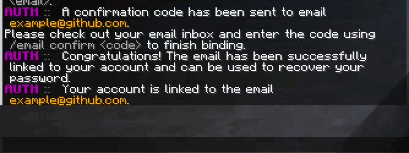

# SkarvexAuthentication 


Skarvex is an authentication system for Minecraft networks running on Velocity and Paper.

The project is split into multiple modules, such as:
- **auth-core** - contains shared business logic, JDBC and MongoDB implementations and interfaces
- **auth-velocity** - contains authentication proxy plugin with commands and database integration (including Flyway migrations)
- **auth-paper** - contains gameplay restrictions before authentication (world protection, lobby location, and player visibility)

## Features

- **Authentication System:** Full support for player registration, login, session management, and logout (`/register`, `/login`, `/logout`).
- **Email Integration:** Complete email management flow (`/email link`, `/email info`, `/email confirm`, `/email unlink`) with SMTP support and customizable message templates.
- **Security & Protection:** BCrypt password hashing, IP-based brute-force protection powered by Caffeine Cache, and automatic re-authentication for players connecting from recognized IP addresses.
- **Database Support:** Configurable MySQL and MongoDB backends. MySQL uses HikariCP for efficient connection pooling and Flyway for automated database schema migrations.
- **Account Management:** In-game password changing (`/changepass`) and email management commands.
- **Modular Architecture:** Multi-module Gradle architecture separating shared authentication logic from Velocity and Paper platform integrations.

## Previews

<table>
  <tr>
    <td align="center">
      <b>Login</b><br>
      <a href="docs/login_skarvex.gif">
        
      </a>
    </td>
    <td align="center">
      <b>Register</b><br>
      <a href="docs/registration_skarvex.gif">
        
      </a>
    </td>
  </tr>
  <tr>
    <td align="center">
      <b>Logout</b><br>
      <a href="docs/logout_skarvex.gif">
        
      </a>
    </td>
    <td align="center">
      <b>Change Password</b><br>
      <a href="docs/change_password_skarvex.gif">
        
      </a>
    </td>
  </tr>
<td align="center">
      <b>Email Binding & Verification</b><br>
      <a href="docs/email_link_skarvex.gif">
        
      </a>
    </td>
    <td align="center">
      <b>Email Unlinking</b><br>
      <a href="docs/email_unlink_skarvex.gif">
        
      </a>
    </td>
</table>

## Structure

```
auth-core 
├─ services 
├─ repositories 
├─ security 
├─ utils
└─ models 

auth-velocity 
├─ commands
├─ utils 
├─ managers
├─ database 
└─ schedulers 

auth-paper 
├─ listeners 
├─ managers 
└─ services (gameplay restrictions)
```

## Commands

| Command | Usage | Description |
| :--- | :--- | :--- |
| `/register` | `/register <password> <confirmPassword>` | Register a new account |
| `/login` | `/login <password>` | Log in to your account |
| `/logout` | `/logout` | Terminate current session |
| `/changepass` | `/changepass <oldPassword> <newPassword>` | Change your account password |
| `/email link` | `/email link <address>` | Send confirmation code to email |
| `/email confirm` | `/email confirm <code>` | Verify code and bind email |
| `/email unlink` | `/email unlink` | Unbind current email from account |
| `/email info` | `/email info` | View linked email status |

## Requirements

- Java 21
- Velocity 3.x (and higher)
- Paper 1.20+
- MySQL or MongoDB

## Configuration
1. Run the proxy and backend server once to generate the configuration files.
2. Open `plugins/SkarvexAuthentication/config.yml` on Velocity and configure your database and SMTP server:

```yaml
# Database Connection
database:
  type: MYSQL # Supported: MYSQL, MONGODB

  # JDBC configuration
  jdbc:
    host: localhost
    port: 3306
    database: auth
    username: "root"
    password: "root"

    pool:
      max-size: 10
      min-idle: 2

  # MongoDB configuration
  mongodb:
    host: localhost
    port: 27017
    database: auth
    username: root
    password: "password"
    authentication-database: admin

# SMTP Mail Connection
smtp:
  host: "smtp.gmail.com"
  port: 587
  username: "your-email@gmail.com"
  password: "app-password" # Use App Passwords for Gmail/Outlook
```

## Building

```./gradlew build```

Compiled jars will be available in:
```
auth-paper/build/libs/
auth-velocity/build/libs/
```

## License

This project is licensed under the MIT License.

You are free to use, modify, distribute, and contribute to the project in accordance with the license terms.

[See the LICENSE file for details.](/LICENSE)

## Author

Developed and maintained by nobodyinvited.

GitHub: https://github.com/nobodyinvited

## Contributing

Contributions, bug reports, and feature suggestions are welcome.

If you find an issue or would like to propose an improvement, feel free to open an issue or submit a pull request.
